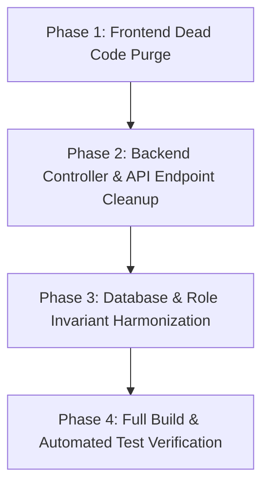

# Static Code Audit & Impact Analysis: Legacy "Customer Portal" & "Customer Role"

**Application:** iM3Helpdesk (DeskMate)  
**Analysis Type:** Principal Code Audit & Impact Analysis (Static Analysis)  
**Target Codebases:** Backend (.NET 8) & Frontend (Angular 17+)  
**Status:** Read-Only Audit Completed (Awaiting Remediation Confirmation)

---

## 1. Executive Summary

A comprehensive static code analysis across both the **Frontend (Angular)** and **Backend (.NET 8)** codebases confirms that substantial legacy dead code remnants of an interactive **"Customer Portal"** and **"Customer Role"** exist within the application.

While the system's active business model handles external customers exclusively via **inbound email-to-ticket conversion** (preserving sender name, email, and contact profiles without credentials), older scaffolding for customer self-service remains partially wired:
- **Frontend:** Dedicated self-registration pages, customer portal views, customer ticket detail pages, an unused route guard, a customer HTTP service, customer login redirect branches, and customer-specific sidebar navigation tabs.
- **Backend:** A dedicated `CustomersController` exposing customer portal API endpoints, customer registration endpoints and DTOs, a fourth `UserRole.Customer` enum value (which currently serves as the default initialization on the `User` entity), and an inbound email controller that still auto-creates customer user accounts.

Purging this dead code will eliminate technical debt, close unauthenticated self-registration attack vectors, and enforce the strict 3-role security model (**SuperAdmin**, **CompanyAdmin**, **Agent**).

---

## 2. Identified Dead Files & Modules

### A. Frontend (Angular)

#### 1. Dead Standalone Files to Delete
| File | Type | Description |
| :--- | :--- | :--- |
| [`customer.guard.ts`](file:///f:/Applications/Practice/iM3HelpDesk/frontend/src/app/core/guards/customer.guard.ts#L5-L20) | Route Guard | Checks `authService.getUserRole() !== 'Customer'`. Completely unused across all routes in `app.routes.ts`. |
| [`customer.service.ts`](file:///f:/Applications/Practice/iM3HelpDesk/frontend/src/app/core/services/customer.service.ts#L7-L28) | Angular Service | Calls dead API endpoints: `/Customer/my-tickets`, `/Customer/submit-ticket`, and `/Customer/my-tickets/{id}/reply`. |
| [`customer-portal.component.ts`](file:///f:/Applications/Practice/iM3HelpDesk/frontend/src/app/features/customer/customer-portal/customer-portal.component.ts#L18-L138) | Component | Customer ticket list & ticket submission form UI. |
| [`customer-portal.html`](file:///f:/Applications/Practice/iM3HelpDesk/frontend/src/app/features/customer/customer-portal/customer-portal.html) | Template | Portal layout for listing customer tickets and creation modal. |
| [`customer-portal.scss`](file:///f:/Applications/Practice/iM3HelpDesk/frontend/src/app/features/customer/customer-portal/customer-portal.scss) | Stylesheet | Styles for the customer portal component. |
| [`customer-ticket-detail.component.ts`](file:///f:/Applications/Practice/iM3HelpDesk/frontend/src/app/features/customer/customer-ticket-detail/customer-ticket-detail.component.ts#L14-L112) | Component | Customer view of ticket conversation thread & reply box. |
| [`customer-ticket-detail.html`](file:///f:/Applications/Practice/iM3HelpDesk/frontend/src/app/features/customer/customer-ticket-detail/customer-ticket-detail.html) | Template | Template for customer ticket viewing and replying. |
| [`customer-ticket-detail.scss`](file:///f:/Applications/Practice/iM3HelpDesk/frontend/src/app/features/customer/customer-ticket-detail/customer-ticket-detail.scss) | Stylesheet | Styles for customer ticket detail view. |
| [`register-customer.component.ts`](file:///f:/Applications/Practice/iM3HelpDesk/frontend/src/app/features/auth/register-customer/register-customer.component.ts#L9-L75) | Component | Customer self-onboarding form calling `/Auth/register-customer`. |
| [`register-customer.html`](file:///f:/Applications/Practice/iM3HelpDesk/frontend/src/app/features/auth/register-customer/register-customer.html) | Template | Template with organization slug, email, password, and confirmation fields. |
| [`register-customer.scss`](file:///f:/Applications/Practice/iM3HelpDesk/frontend/src/app/features/auth/register-customer/register-customer.scss) | Stylesheet | Styles for customer registration view. |
| `frontend/src/app/features/customer/` | Directory | Entire directory container containing the customer feature components. |
| `frontend/src/app/features/auth/register-customer/` | Directory | Directory container for the dead customer registration component. |

#### 2. Dead Code Blocks / Logic Branches in Shared Frontend Files
- **Routes ([`app.routes.ts`](file:///f:/Applications/Practice/iM3HelpDesk/frontend/src/app/app.routes.ts#L58-L61) & [L258-L268](file:///f:/Applications/Practice/iM3HelpDesk/frontend/src/app/app.routes.ts#L258-L268)):**
  - Route `'register-customer'` (`RegisterCustomerComponent`).
  - Route `'customer/ticket/:id'` (`CustomerTicketDetailComponent`).
  - Route `'customer'` (`CustomerPortalComponent`).
- **Auth Service ([`auth.service.ts`](file:///f:/Applications/Practice/iM3HelpDesk/frontend/src/app/core/services/auth.service.ts#L92-L96)):**
  - `registerCustomer(data)` method making HTTP POST to `${this.apiUrl}/register-customer`.
- **Login Component ([`login.component.ts`](file:///f:/Applications/Practice/iM3HelpDesk/frontend/src/app/features/auth/login/login.component.ts#L389-L393)):**
  - `else if (role === 'Customer') this.router.navigate(['/customer']);`
- **Register Template ([`register.html`](file:///f:/Applications/Practice/iM3HelpDesk/frontend/src/app/features/auth/register/register.html#L122)):**
  - Link `<a routerLink="/register-customer" class="create-link">Customer Portal Signup</a>`.
- **Main Layout ([`layout.html`](file:///f:/Applications/Practice/iM3HelpDesk/frontend/src/app/layouts/main-layout/layout.html#L257-L280) & [`layout.component.ts`](file:///f:/Applications/Practice/iM3HelpDesk/frontend/src/app/layouts/main-layout/layout.component.ts#L196-L199)):**
  - `isCustomer` state property and `goToCustomerPortal()` method in [layout.component.ts:196-199, 274, 411, 677](file:///f:/Applications/Practice/iM3HelpDesk/frontend/src/app/layouts/main-layout/layout.component.ts#L196-L199).
  - Customer-specific sidebar `<nav class="sidebar-nav" *ngIf="isCustomer">` and header `
` in [layout.html:257-280, 322](file:///f:/Applications/Practice/iM3HelpDesk/frontend/src/app/layouts/main-layout/layout.html#L257-L280).
  - Negative guard checks `*ngIf="!isSuperAdmin && !isCustomer"` throughout topbar icons (simplify to `!isSuperAdmin`).
- **SuperAdmin All Users ([`all-users.component.ts`](file:///f:/Applications/Practice/iM3HelpDesk/frontend/src/app/features/super-admin/all-users/all-users.component.ts#L42), [`all-users.html`](file:///f:/Applications/Practice/iM3HelpDesk/frontend/src/app/features/super-admin/all-users/all-users.html#L28-L30), and [`all-users.scss`](file:///f:/Applications/Practice/iM3HelpDesk/frontend/src/app/features/super-admin/all-users/all-users.scss#L67)):**
  - `'Customer'` role option and styling pill in the SuperAdmin user directory filter.
- **Role Rights Matrix ([`role-rights.component.ts`](file:///f:/Applications/Practice/iM3HelpDesk/frontend/src/app/features/settings/role-rights/role-rights.component.ts#L251-L264)):**
  - `case 'Customer': return '🙋';` and `case 'Customer': return 'Portal access only';`.
- **Knowledge Base ([`kb-list.component.ts`](file:///f:/Applications/Practice/iM3HelpDesk/frontend/src/app/features/knowledge-base/kb-list/kb-list.component.ts#L96-L107) & [`kb-detail.component.ts`](file:///f:/Applications/Practice/iM3HelpDesk/frontend/src/app/features/knowledge-base/kb-detail/kb-detail.component.ts#L225)):**
  - `const publishedOnly = this.userRole === 'Customer';` and `return this.userRole === 'Customer' ? '/customer' : '/kb';`.
- **Plan Catalog Marketing Matrix ([`plans.data.ts`](file:///f:/Applications/Practice/iM3HelpDesk/frontend/src/app/features/subscription-plans/explore-plans/plans.data.ts#L222-L230)):**
  - `customerPortal` marketing feature item (`key: 'customer-portal'`).
- **Shared Styles ([`_mixins.scss`](file:///f:/Applications/Practice/iM3HelpDesk/frontend/src/styles/_mixins.scss#L37-L45), [`_forms.scss`](file:///f:/Applications/Practice/iM3HelpDesk/frontend/src/styles/_forms.scss#L1-L10), [`_buttons.scss`](file:///f:/Applications/Practice/iM3HelpDesk/frontend/src/styles/_buttons.scss#L48-L58)):**
  - `app-register-customer` styling rules and `&.customer` badge styles.

---

### B. Backend (.NET 8)

#### 1. Dead Standalone Files to Delete
| File | Layer | Description |
| :--- | :--- | :--- |
| [`CustomersController.cs`](file:///f:/Applications/Practice/iM3HelpDesk/backend/iM3Helpdesk.API/Controllers/CustomersController.cs#L14-L313) | `iM3Helpdesk.API` | Exposes `/api/Customers` and `/api/Customer` (`my-tickets`, `my-tickets/{id}`, `submit-ticket`, `my-tickets/{id}/reply`) and inline DTOs `SubmitTicketDto`, `AddReplyDto`. |
| [`RegisterCustomerDto.cs`](file:///f:/Applications/Practice/iM3HelpDesk/backend/iM3Helpdesk.Application/DTOs/Auth/RegisterCustomerDto.cs#L1-L12) | `iM3Helpdesk.Application` | DTO used strictly for customer portal registration. |

#### 2. Dead Code Blocks / Logic Branches in Backend Files
- **Auth Controller ([`AuthController.cs`](file:///f:/Applications/Practice/iM3HelpDesk/backend/iM3Helpdesk.API/Controllers/AuthController.cs#L124-L131)):**
  - `[HttpPost("register-customer")]` endpoint delegating to `_authService.RegisterCustomerAsync`.
- **Auth Service & Contract ([`IAuthService.cs`](file:///f:/Applications/Practice/iM3HelpDesk/backend/iM3Helpdesk.Application/Contracts/Services/IAuthService.cs#L17-L18) & [`AuthService.cs`](file:///f:/Applications/Practice/iM3HelpDesk/backend/iM3Helpdesk.Application/Services/AuthService.cs#L186-L226)):**
  - `RegisterCustomerAsync(RegisterCustomerDto dto, ...)` implementation that instantiates `new User { Role = UserRole.Customer, ... }`.
- **Inbound Email Webhook Controller ([`InboundEmailController.cs`](file:///f:/Applications/Practice/iM3HelpDesk/backend/iM3Helpdesk.API/Controllers/InboundEmailController.cs#L182-L209)):**
  - Lines 182–209: Auto-creates a `User` entity with `Role = UserRole.Customer` when an inbound email webhook arrives and sets `ticket.CreatedByUserId = customer.Id`. *(Note: This contradicts [`EmailPollingService.cs:311-339`](file:///f:/Applications/Practice/iM3HelpDesk/backend/iM3Helpdesk.Infrastructure/Services/EmailPollingService.cs#L311-L339) which correctly disabled customer user creation and sets `CreatedByUserId = null`).*
- **User Role Enum ([`UserRole.cs`](file:///f:/Applications/Practice/iM3HelpDesk/backend/iM3Helpdesk.Domain/Enums/UserRole.cs#L4-L10)):**
  - `UserRole.Customer` enum value.
- **User Entity Invariant ([`User.cs`](file:///f:/Applications/Practice/iM3HelpDesk/backend/iM3Helpdesk.Domain/Entities/User.cs#L14)):**
  - `public UserRole Role { get; set; } = UserRole.Customer;` (critical bug/dead default: defaults unassigned roles to `Customer` rather than `Agent`).
- **User Repository ([`UserRepository.cs`](file:///f:/Applications/Practice/iM3HelpDesk/backend/iM3Helpdesk.Infrastructure/Repositories/UserRepository.cs#L102-L117)):**
  - `GetAgentsAsync` query explicitly includes `u.Role == Domain.Enums.UserRole.Customer`.
- **Role Rights & Permissions ([`RoleRightsController.cs`](file:///f:/Applications/Practice/iM3HelpDesk/backend/iM3Helpdesk.API/Controllers/RoleRightsController.cs#L113-L137) & [`PermissionService.cs`](file:///f:/Applications/Practice/iM3HelpDesk/backend/iM3Helpdesk.Infrastructure/Services/PermissionService.cs#L114-L119)):**
  - Inclusion of `UserRole.Customer` in `OrderedRoles`.
  - Default permissions branch `if (role == UserRole.Customer)` generating ticket/KB/notification visibility for customers.
- **Agent Service ([`AgentService.cs`](file:///f:/Applications/Practice/iM3HelpDesk/backend/iM3Helpdesk.Application/Services/AgentService.cs#L299-L414)):**
  - `ParseBulkRole` and `ParseRole` parsing `"Customer"` / `"customer"` to `UserRole.Customer` during agent creation and Excel bulk import.
- **Ticket Service & Repository ([`TicketService.cs`](file:///f:/Applications/Practice/iM3HelpDesk/backend/iM3Helpdesk.Application/Services/TicketService.cs#L51-L75), [`ITicketRepository.cs`](file:///f:/Applications/Practice/iM3HelpDesk/backend/iM3Helpdesk.Application/Contracts/Persistence/ITicketRepository.cs#L11-L13), [`TicketRepository.cs`](file:///f:/Applications/Practice/iM3HelpDesk/backend/iM3Helpdesk.Infrastructure/Repositories/TicketRepository.cs#L78-L135)):**
  - `isCustomer` argument and `CreatedByUserId == userId` branching in `GetMyStatusCountsAsync`.
  - `customerUserId` filter in `GetCalendarTicketsAsync`.
- **Subscription Seeder ([`SubscriptionSeeder.cs`](file:///f:/Applications/Practice/iM3HelpDesk/backend/iM3Helpdesk.Infrastructure/Services/SubscriptionSeeder.cs#L38-L50)):**
  - Feature key `"customer-portal"` seeded in Growth/Enterprise default plan strings.
- **Email Polling Service ([`EmailPollingService.cs`](file:///f:/Applications/Practice/iM3HelpDesk/backend/iM3Helpdesk.Infrastructure/Services/EmailPollingService.cs#L311-L339) & [L549-L568](file:///f:/Applications/Practice/iM3HelpDesk/backend/iM3Helpdesk.Infrastructure/Services/EmailPollingService.cs#L549-L568)):**
  - Lines 311–339: Commented-out dead legacy customer user creation code block.
  - Lines 549–568: Step 5 duplicate detection query searching for registered `User` by `fromEmail` to match `CreatedByUserId`.
- **Internal Defensive Role Checks ([`CallLogsController.cs`](file:///f:/Applications/Practice/iM3HelpDesk/backend/iM3Helpdesk.API/Controllers/CallLogsController.cs#L96-L109) & [`ChatController.cs`](file:///f:/Applications/Practice/iM3HelpDesk/backend/iM3Helpdesk.API/Controllers/ChatController.cs#L71-L86)):**
  - `u.Role != UserRole.Customer` filters used to exclude customers from internal staff call logs and internal chat rosters.
- **Test Suites ([`EmailThreadingIntegrationTests.cs`](file:///f:/Applications/Practice/iM3HelpDesk/backend/iM3Helpdesk.API.Tests/Integration/EmailThreadingIntegrationTests.cs#L33-L41), [`TicketsControllerTests.cs`](file:///f:/Applications/Practice/iM3HelpDesk/backend/iM3Helpdesk.API.Tests/Controllers/TicketsControllerTests.cs#L40-L45), [`TenantMiddlewareTests.cs`](file:///f:/Applications/Practice/iM3HelpDesk/backend/iM3Helpdesk.API.Tests/Infrastructure/TenantMiddlewareTests.cs#L96-L101)):**
  - Test fixtures manually seeding `UserRole.Customer` or `"Customer"` role claims.

---

## 3. Legitimate Features to Preserve

It is critical **NOT** to remove or break legitimate customer/contact data structures that are essential for support operations:

1. **`Contact` Entity & [`ContactsController.cs`](file:///f:/Applications/Practice/iM3HelpDesk/backend/iM3Helpdesk.API/Controllers/ContactsController.cs):**
   - The `Contact` entity (`FullName`, `Email`, `PhoneNumber`, `Company`, `Source`) represents external customers and sender directory entries. It is actively displayed in the agent CRM/contacts views and created during email polling. This must remain intact.
2. **Ticket Requester Metadata on [`Ticket.cs`](file:///f:/Applications/Practice/iM3HelpDesk/backend/iM3Helpdesk.Domain/Entities/Ticket.cs#L11-L13):**
   - Properties `FromName`, `FromEmail`, `InboundMessageId`, and `TicketNumber` store the external customer's identity for inbound email tickets where `CreatedByUserId` is `null`.
3. **Comment Sender Metadata on [`TicketComment.cs`](file:///f:/Applications/Practice/iM3HelpDesk/backend/iM3Helpdesk.Domain/Entities/TicketComment.cs#L8-L16):**
   - Properties `FromName` and `FromEmail` on comments where `UserId` is `null` represent external customer responses received via email threading.
4. **Automated Customer Email Notifications ([`EmailService.cs`](file:///f:/Applications/Practice/iM3HelpDesk/backend/iM3Helpdesk.Infrastructure/Services/EmailService.cs) & [`ITicketNotificationService.cs`](file:///f:/Applications/Practice/iM3HelpDesk/backend/iM3Helpdesk.Application/Contracts/Services/ITicketNotificationService.cs)):**
   - Outbound transactional emails sent to the requester (ticket creation confirmations, status updates, agent replies, resolution notices). Template variables named `customerName` or `customer_name` are actively used for email personalization.
5. **Smart Assign Customer Continuity ([`SmartAssignService.cs`](file:///f:/Applications/Practice/iM3HelpDesk/backend/iM3Helpdesk.Infrastructure/Services/SmartAssignService.cs#L87-L225)):**
   - AI and heuristic assignment scoring based on previous tickets resolved for the same external customer (matched via `ticket.FromEmail`).
6. **Ticket Duplicate Detection (`SameCustomer` in [`TicketService.cs`](file:///f:/Applications/Practice/iM3HelpDesk/backend/iM3Helpdesk.Application/Services/TicketService.cs#L367-L379)):**
   - Heuristics that flag potential duplicate tickets from the same sender email/requester.
7. **Role Rights "Customers" Module Key (`"customers"`):**
   - In [`RoleRightsController.cs`](file:///f:/Applications/Practice/iM3HelpDesk/backend/iM3Helpdesk.API/Controllers/RoleRightsController.cs#L91) and [`PermissionService.cs`](file:///f:/Applications/Practice/iM3HelpDesk/backend/iM3Helpdesk.Infrastructure/Services/PermissionService.cs#L98), `"customers"` is an agent-facing permission module (sub-view of contacts) controlling which agents can view/edit customer contacts. This is legitimate and distinct from customer portal login.

---

## 4. Impact & Risk Analysis

### A. Route & UI Impact
- **Shared Routes:** Removing `/register-customer`, `/customer`, and `/customer/ticket/:id` will not break any agent or admin workflows.
- **Login Redirect:** Removing the `role === 'Customer'` branch in `login.component.ts` ensures only valid staff roles navigate into `/admin` or `/dashboard`.
- **Navigation Cleanup:** Removing the `isCustomer` sidebar in `layout.html` simplifies the UI template and removes confusing "My Support" / "Support Portal Gateway" dead markup.

### B. Dependency Injection & Service Registrations
- Neither `CustomersController` nor `CustomerService` is registered as an explicit interface/service dependency in `Program.cs` or Angular's root providers.
- Purging `CustomersController.cs` and `CustomerService.ts` introduces **zero DI compilation failures**.

### C. Database & Entity Framework Blast Radius
- **Enum Mapping Risk:** In EF Core, `UserRole` is stored as an integer:
  $$\text{SuperAdmin} = 0, \quad \text{CompanyAdmin} = 1, \quad \text{Agent} = 2, \quad \text{Customer} = 3$$
  If `UserRole.Customer` is deleted from C# while the database contains existing rows in `Users` with `Role = 3` or in `RolePermissions` with `Role = 3`, EF Core will throw runtime deserialization errors.
  *Remediation Requirement:* Before removing `UserRole.Customer` from the enum, any existing database records with `Role = 3` must be migrated or purged via SQL/EF migration.
- **`User.cs` Default Property:** Changing `public UserRole Role { get; set; } = UserRole.Customer;` to default to `UserRole.Agent` eliminates the risk of newly created accounts inadvertently gaining a deprecated role.
- **Inbound Email Webhook Drift:** [`InboundEmailController.cs:182-209`](file:///f:/Applications/Practice/iM3HelpDesk/backend/iM3Helpdesk.API/Controllers/InboundEmailController.cs#L182-L209) is actively auto-creating `User` records with `Role = UserRole.Customer`. If the customer role is purged without updating this controller, inbound email webhooks will throw runtime exceptions. It must be updated to align with `EmailPollingService.cs` (creating a `Contact` and leaving `ticket.CreatedByUserId = null`).

### D. Automated Test Suites
- Three test files ([`EmailThreadingIntegrationTests.cs`](file:///f:/Applications/Practice/iM3HelpDesk/backend/iM3Helpdesk.API.Tests/Integration/EmailThreadingIntegrationTests.cs), [`TicketsControllerTests.cs`](file:///f:/Applications/Practice/iM3HelpDesk/backend/iM3Helpdesk.API.Tests/Controllers/TicketsControllerTests.cs), and [`TenantMiddlewareTests.cs`](file:///f:/Applications/Practice/iM3HelpDesk/backend/iM3Helpdesk.API.Tests/Infrastructure/TenantMiddlewareTests.cs)) currently seed `UserRole.Customer`. Updating them to `UserRole.Agent` or `UserRole.CompanyAdmin` will maintain 100% test pass rates without dependency on the customer role.

---

## 5. Recommended Remediation Plan

### Phase 1: Frontend Dead Code Purge
1. Delete dead files:
   - `frontend/src/app/core/guards/customer.guard.ts`
   - `frontend/src/app/core/services/customer.service.ts`
   - `frontend/src/app/features/customer/` (all 6 files & subdirectories)
   - `frontend/src/app/features/auth/register-customer/` (all 3 files & directory)
2. Clean up route definitions in [`app.routes.ts`](file:///f:/Applications/Practice/iM3HelpDesk/frontend/src/app/app.routes.ts) (`register-customer`, `customer`, `customer/ticket/:id`).
3. Remove dead methods and links:
   - Remove `registerCustomer()` from [`auth.service.ts`](file:///f:/Applications/Practice/iM3HelpDesk/frontend/src/app/core/services/auth.service.ts).
   - Remove Customer Portal signup link from [`register.html`](file:///f:/Applications/Practice/iM3HelpDesk/frontend/src/app/features/auth/register/register.html).
   - Remove `role === 'Customer'` redirect from [`login.component.ts`](file:///f:/Applications/Practice/iM3HelpDesk/frontend/src/app/features/auth/login/login.component.ts).
   - Remove `isCustomer` navigation block, topbar checks, and `goToCustomerPortal()` from [`layout.html`](file:///f:/Applications/Practice/iM3HelpDesk/frontend/src/app/layouts/main-layout/layout.html) & [`layout.component.ts`](file:///f:/Applications/Practice/iM3HelpDesk/frontend/src/app/layouts/main-layout/layout.component.ts).
   - Remove `Customer` role options from [`all-users.component.ts`](file:///f:/Applications/Practice/iM3HelpDesk/frontend/src/app/features/super-admin/all-users/all-users.component.ts), [`role-rights.component.ts`](file:///f:/Applications/Practice/iM3HelpDesk/frontend/src/app/features/settings/role-rights/role-rights.component.ts), [`kb-list.component.ts`](file:///f:/Applications/Practice/iM3HelpDesk/frontend/src/app/features/knowledge-base/kb-list/kb-list.component.ts), and [`kb-detail.component.ts`](file:///f:/Applications/Practice/iM3HelpDesk/frontend/src/app/features/knowledge-base/kb-detail/kb-detail.component.ts).
   - Clean up `app-register-customer` styles in `_mixins.scss`, `_forms.scss`, `_buttons.scss`.

### Phase 2: Backend Controller & API Cleanup
1. Delete dead files:
   - `backend/iM3Helpdesk.API/Controllers/CustomersController.cs`
   - `backend/iM3Helpdesk.Application/DTOs/Auth/RegisterCustomerDto.cs`
2. Remove customer registration:
   - Remove `[HttpPost("register-customer")]` from [`AuthController.cs`](file:///f:/Applications/Practice/iM3HelpDesk/backend/iM3Helpdesk.API/Controllers/AuthController.cs).
   - Remove `RegisterCustomerAsync` from [`IAuthService.cs`](file:///f:/Applications/Practice/iM3HelpDesk/backend/iM3Helpdesk.Application/Contracts/Services/IAuthService.cs) and [`AuthService.cs`](file:///f:/Applications/Practice/iM3HelpDesk/backend/iM3Helpdesk.Application/Services/AuthService.cs).
3. Align [`InboundEmailController.cs`](file:///f:/Applications/Practice/iM3HelpDesk/backend/iM3Helpdesk.API/Controllers/InboundEmailController.cs):
   - Replace auto-creation of `User` (`Role = UserRole.Customer`) with `FindOrCreateContactAsync` (matching `EmailPollingService.cs`), setting `ticket.CreatedByUserId = null`.

### Phase 3: Role & Schema Harmonization
1. Update [`User.cs`](file:///f:/Applications/Practice/iM3HelpDesk/backend/iM3Helpdesk.Domain/Entities/User.cs):
   - Change default role initialization to `public UserRole Role { get; set; } = UserRole.Agent;`.
2. Update [`UserRepository.cs`](file:///f:/Applications/Practice/iM3HelpDesk/backend/iM3Helpdesk.Infrastructure/Repositories/UserRepository.cs):
   - Remove `u.Role == Domain.Enums.UserRole.Customer` from `GetAgentsAsync`.
3. Update [`AgentService.cs`](file:///f:/Applications/Practice/iM3HelpDesk/backend/iM3Helpdesk.Application/Services/AgentService.cs):
   - Remove `"Customer"` role parsing.
4. Update [`PermissionService.cs`](file:///f:/Applications/Practice/iM3HelpDesk/backend/iM3Helpdesk.Infrastructure/Services/PermissionService.cs) & [`RoleRightsController.cs`](file:///f:/Applications/Practice/iM3HelpDesk/backend/iM3Helpdesk.API/Controllers/RoleRightsController.cs):
   - Remove `UserRole.Customer` from `OrderedRoles` and default permission generation.
5. Simplify [`TicketService.cs`](file:///f:/Applications/Practice/iM3HelpDesk/backend/iM3Helpdesk.Application/Services/TicketService.cs), [`ITicketRepository.cs`](file:///f:/Applications/Practice/iM3HelpDesk/backend/iM3Helpdesk.Application/Contracts/Persistence/ITicketRepository.cs), and [`TicketRepository.cs`](file:///f:/Applications/Practice/iM3HelpDesk/backend/iM3Helpdesk.Infrastructure/Repositories/TicketRepository.cs):
   - Remove `isCustomer` argument and customer branching from status count and calendar queries.
6. Remove dead commented-out code in [`EmailPollingService.cs`](file:///f:/Applications/Practice/iM3HelpDesk/backend/iM3Helpdesk.Infrastructure/Services/EmailPollingService.cs).
7. Remove defensive `u.Role != UserRole.Customer` checks in [`CallLogsController.cs`](file:///f:/Applications/Practice/iM3HelpDesk/backend/iM3Helpdesk.API/Controllers/CallLogsController.cs) and [`ChatController.cs`](file:///f:/Applications/Practice/iM3HelpDesk/backend/iM3Helpdesk.API/Controllers/ChatController.cs).
8. Remove `"customer-portal"` feature key from [`SubscriptionSeeder.cs`](file:///f:/Applications/Practice/iM3HelpDesk/backend/iM3Helpdesk.Infrastructure/Services/SubscriptionSeeder.cs).
9. Safe retirement of `UserRole.Customer`:
   - Run EF migration / SQL update to convert any existing database rows with `Role = 3` to `Role = 2` (Agent) or delete orphaned customer user test records, then remove `Customer` from [`UserRole.cs`](file:///f:/Applications/Practice/iM3HelpDesk/backend/iM3Helpdesk.Domain/Enums/UserRole.cs).

### Phase 4: Build & Test Verification
1. Run `dotnet build` across backend solutions to verify 0 errors and 0 warnings.
2. Update unit tests in [`API.Tests`](file:///f:/Applications/Practice/iM3HelpDesk/backend/iM3Helpdesk.API.Tests) and run `dotnet test` (verifying 64/64 tests pass).
3. Run `npm run build` in `frontend` to verify 0 TypeScript/compilation errors and clean chunk bundling.
4. Run `npm test -- --watch=false` in `frontend` to verify 100% test pass rate.
