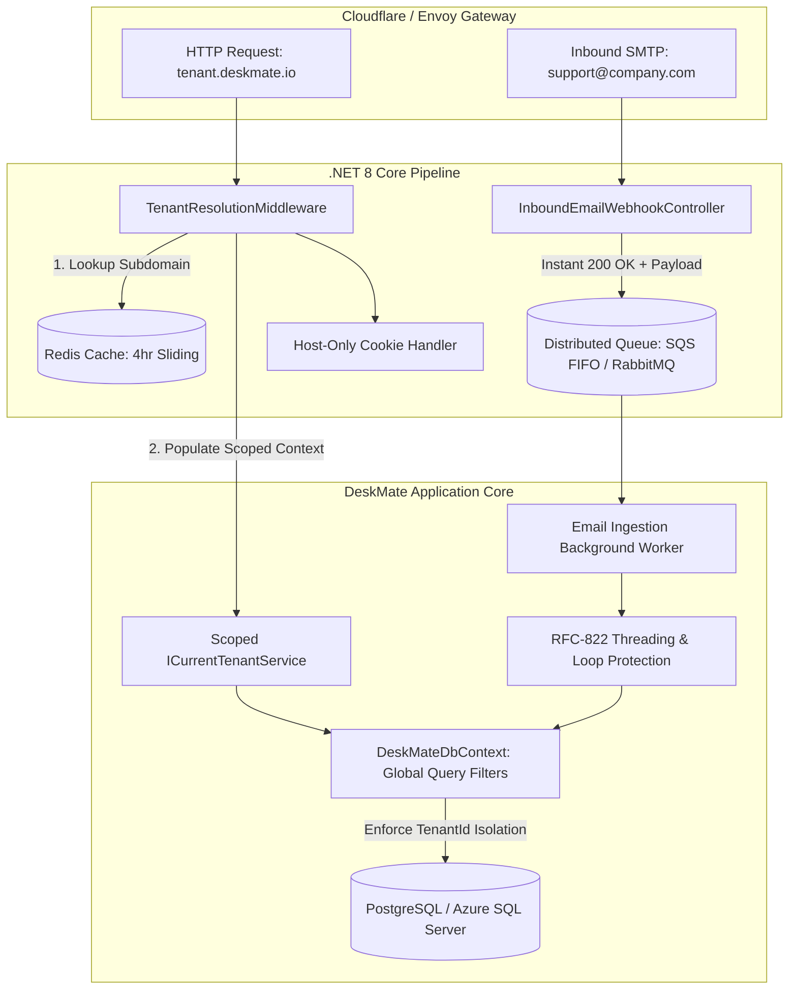
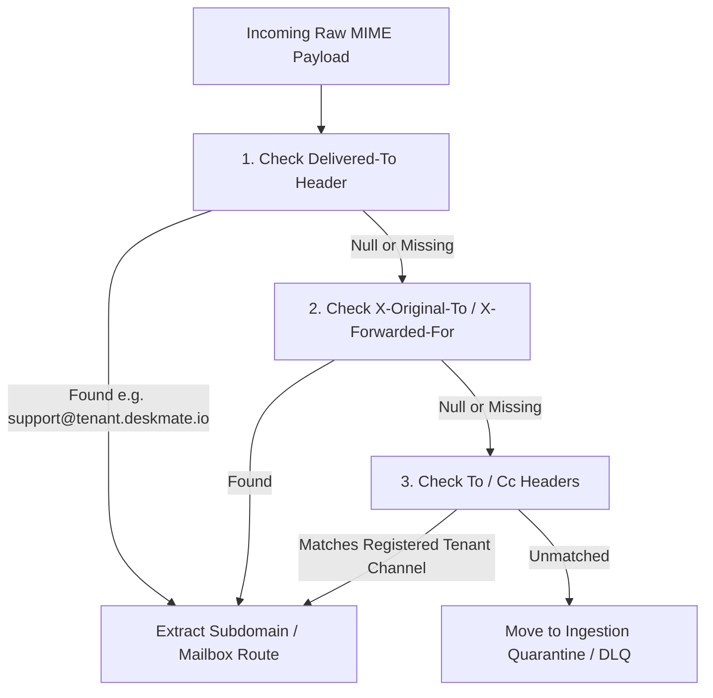

# DeskMate Enterprise Architectural Blueprint & Implementation Specification
**Document Version:** 1.0.0  
**Target Platform:** .NET 8 Web API + Angular 18 Enterprise SPA  
**System Classification:** Multi-Tenant Distributed SaaS Customer Support Platform (DeskMate / iM3HelpDesk)  
**Derived From:** Enterprise Reverse-Engineering Analysis of Freshdesk Platform Architecture (`https://peopleplussoftwareassist.freshdesk.com/support/home`)

---

## 1. Architectural Pillar Overview & Design Principles

### 1.1 Context & Current vs. Enterprise Target State

The DeskMate application (formerly `iM3HelpDesk`) currently operates with foundational multi-tenant data structures, but requires an enterprise-grade architectural overhaul to support high-scale concurrent tenants, deterministic email-to-ticket threading, robust session boundary enforcement, and sub-second inbound message processing.

The empirical analysis of Freshdesk (`peopleplussoftwareassist.freshdesk.com`), executed via the REA (Reverse Engineer Anything) toolkit, revealed five critical architectural pillars that enable enterprise SaaS resilience, horizontal scalability, and multi-tenant security:

| Architectural Dimension | DeskMate Prototype / Legacy State | Targeted Enterprise Standard (DeskMate v2.0) |
| :--- | :--- | :--- |
| **Session Boundary Security** | Wildcard / broad domain cookies (`Domain=.deskmate.io`) vulnerable to cross-tenant session leaks and DNS injection. | **Host-Only Cookies:** Strict omission of the `Domain` attribute, binding sessions cryptographically and logically to specific tenant subdomains (`company.deskmate.io`). |
| **Email-to-Ticket Correlation** | Brittle regex parsing of subject lines (`[#1024]`), susceptible to email client subject mutations and ticket enumeration attacks. | **RFC-822 Deterministic Threading:** Primary matching on `In-Reply-To` and `References` headers against indexed message trees, with validated subject fallback. |
| **Email Ingestion Engine** | Naive 5-second IMAP polling loops causing thread pool exhaustion, socket blocking, and failure beyond ~50 mailboxes. | **Event-Driven Webhook Ingestion:** Push-based Inbound MX webhooks buffered through AWS SQS FIFO / RabbitMQ with Redis 72-hour idempotency keys. |
| **Tenant Context Resolution** | Per-request database roundtrips to resolve tenant headers or URL paths, creating massive database query overhead. | **Distributed Metadata Caching:** Subdomain extraction via high-throughput ASP.NET Core middleware backed by Redis sliding-expiration cache with Pub/Sub invalidation. |
| **Data Isolation & Hydration** | Ad-hoc `WHERE TenantId = @id` queries requiring manual developer vigilance across repositories. | **Kernel-Level Multi-Tenancy:** EF Core Global Query Filters (`IMultiTenantEntity`), automatic `TenantId` stamping in `SaveChangesAsync()`, and zero-delay Angular Signal hydration. |



---

## 2. Pillar 1: Host-Only Cookie Security & Session Boundaries

### 2.1 Threat Vector: DNS Cookie Poisoning & Cross-Subdomain Leaks
In multi-tenant SaaS platforms where customers reside on vanity subdomains (e.g., `tenant-a.deskmate.io` and `tenant-b.deskmate.io`), setting a cookie with `Domain=.deskmate.io` allows *any* compromised or untrusted subdomain to read, overwrite, or hijack sessions belonging to another tenant. Furthermore, malicious scripts executed on a less-secure tenant portal could force cookies onto sibling subdomains (Cookie Tossing).

### 2.2 Specification & Implementation Rule
1. **Omit the `Domain` attribute entirely:** In accordance with RFC 6265 § 4.1.2.3, when the `Domain` attribute is omitted from the `Set-Cookie` header, the user agent creates a **Host-Only** cookie. The cookie is valid *only* for the exact fully qualified domain name (FQDN) in the request URL and is never transmitted to sibling subdomains or parent domains.
2. **Strict Attribute Enforcement:**
   - `HttpOnly = true`: Mitigates XSS token exfiltration.
   - `Secure = true`: Enforces TLS transmission exclusively.
   - `SameSite = SameSiteMode.Lax`: Protects against Cross-Site Request Forgery (CSRF) during top-level navigation while supporting standard SaaS redirect flows.
   - `IsEssential = true`: Ensures compliance with privacy consent requirements.

### 2.3 Production C# Cookie Generator Service

```csharp
using Microsoft.AspNetCore.Http;

namespace DeskMate.Infrastructure.Security;

public interface ICookieSecurityService
{
    void AppendHostOnlySessionCookie(HttpContext context, string cookieName, string token, DateTimeOffset? expires = null);
    void ExpireHostOnlyCookie(HttpContext context, string cookieName);
    string? RetrieveHostOnlyCookie(HttpContext context, string cookieName);
}

/// <summary>
/// Implements Host-Only cookie issuance to guarantee total cross-tenant session isolation.
/// Matches the architectural pattern reverse-engineered from Freshdesk's '_helpkit_session' cookie.
/// </summary>
public class CookieSecurityService : ICookieSecurityService
{
    public void AppendHostOnlySessionCookie(HttpContext context, string cookieName, string token, DateTimeOffset? expires = null)
    {
        ArgumentNullException.ThrowIfNull(context);
        ArgumentException.ThrowIfNullOrWhiteSpace(cookieName);
        ArgumentException.ThrowIfNullOrWhiteSpace(token);

        var cookieOptions = new CookieOptions
        {
            // CRITICAL: Explicitly leave Domain null/empty to enforce RFC 6265 Host-Only status.
            Domain = null, 
            Path = "/",
            HttpOnly = true,
            Secure = true, // Enforce HTTPS transmission
            SameSite = SameSiteMode.Lax,
            Expires = expires ?? DateTimeOffset.UtcNow.AddDays(7),
            IsEssential = true
        };

        context.Response.Cookies.Append(cookieName, token, cookieOptions);
    }

    public void ExpireHostOnlyCookie(HttpContext context, string cookieName)
    {
        ArgumentNullException.ThrowIfNull(context);
        ArgumentException.ThrowIfNullOrWhiteSpace(cookieName);

        context.Response.Cookies.Append(cookieName, string.Empty, new CookieOptions
        {
            Domain = null, // Must match the original host-only specification
            Path = "/",
            HttpOnly = true,
            Secure = true,
            SameSite = SameSiteMode.Lax,
            Expires = DateTimeOffset.UtcNow.AddDays(-1)
        });
    }

    public string? RetrieveHostOnlyCookie(HttpContext context, string cookieName)
    {
        ArgumentNullException.ThrowIfNull(context);
        return context.Request.Cookies[cookieName];
    }
}
```

### 2.4 Verification Checklist & Automated CLI Test
To verify host-only behavior via `curl.exe`:

```bash
# 1. Initiate login on Tenant A subdomain
curl.exe -I -s -S "https://tenant-a.deskmate.io/api/v1/auth/login"

# 2. Verify Output Headers:
# - Set-Cookie MUST NOT contain "Domain=deskmate.io" or "Domain=.deskmate.io"
# - Expected: Set-Cookie: deskmate_session=abc...; path=/; HttpOnly; secure; SameSite=Lax

# 3. Automated Validation Rule (PowerShell):
$res = curl.exe -I -s -S "https://tenant-a.deskmate.io/api/v1/auth/login"
if ($res -match "Set-Cookie:.*Domain=") {
    Write-Error "SECURITY VULNERABILITY: Cookie contains broad Domain attribute! Host-Only violation."
} else {
    Write-Host "PASS: Host-Only cookie isolation verified."
}
```

---

## 3. Pillar 2: Deterministic RFC-822 Inbound Email Threading Engine

### 3.1 Core Logic & Correlation Hierarchy
When an email is received, DeskMate resolves ticket threading using a two-tier hierarchy:

1. **Deterministic RFC-822 Header Resolution (Tier 1):**
   - Check `In-Reply-To` against indexed `TicketMessages.ExternalMessageId`.
   - Iterate through ancestors listed in the `References` header (ordered from root to latest parent).
   - If an indexed match is found within the current tenant, the incoming message is directly appended to the matched `TicketId`.
2. **Subject Token Fallback with Domain Verification (Tier 2):**
   - If headers are missing (e.g., forwarded drafts or legacy clients), extract ticket number via regex: `\[#(?:TICK-|T-)?(\d+)\]`.
   - **Sender Authorization Guard:** If a ticket number is matched from the subject line, the engine verifies that the sender (`From`) matches:
     - The original ticket requester, OR
     - An authorized CC address on the ticket, OR
     - A verified agent/collaborator of that tenant.
   - If the sender is unrecognized, create a **New Ticket** and link the existing ticket as a reference note to prevent ticket enumeration injection.
3. **Loop & Automated Mailer Protection:**
   - Detect headers: `Auto-Submitted: auto-replied`, `Auto-Submitted: auto-generated`, `X-Autoreply: yes`, `Precedence: bulk|junk|bounce`.
   - Prevent outbound auto-responders from triggering infinite feedback loops.

### 3.2 Production C# RFC-822 Threading Engine

```csharp
using System.Text.RegularExpressions;
using Microsoft.EntityFrameworkCore;
using Microsoft.Extensions.Logging;
using DeskMate.Domain.Entities;
using DeskMate.Infrastructure.Persistence;

namespace DeskMate.Infrastructure.Email;

public record ParsedEmailPayload(
    string MessageId,
    string? InReplyTo,
    IReadOnlyList<string> References,
    string From,
    string To,
    string Subject,
    string BodyHtml,
    string BodyText,
    IReadOnlyDictionary<string, string> Headers);

public enum ThreadingResolutionType
{
    Rfc822InReplyTo,
    Rfc822References,
    SubjectTokenMatched,
    NewConversation
}

public record ThreadingResult(
    Guid? MatchedTicketId,
    ThreadingResolutionType ResolutionType,
    bool ShouldSuppressNotification);

public interface IRfc822ThreadingEngine
{
    Task<ThreadingResult> ResolveThreadAsync(Guid tenantId, ParsedEmailPayload email, CancellationToken ct);
}

public class Rfc822ThreadingEngine : IRfc822ThreadingEngine
{
    private readonly DeskMateDbContext _dbContext;
    private readonly ILogger<Rfc822ThreadingEngine> _logger;
    private static readonly Regex SubjectTicketRegex = new(@"\[#(?:TICK-|T-)?(\d+)\]", RegexOptions.Compiled | RegexOptions.IgnoreCase);

    public Rfc822ThreadingEngine(DeskMateDbContext dbContext, ILogger<Rfc822ThreadingEngine> logger)
    {
        _dbContext = dbContext;
        _logger = logger;
    }

    public async Task<ThreadingResult> ResolveThreadAsync(Guid tenantId, ParsedEmailPayload email, CancellationToken ct)
    {
        // 1. Loop and Auto-Reply Protection Check
        if (IsAutomatedMailer(email.Headers))
        {
            _logger.LogInformation("Email {MessageId} flagged as Auto-Submitted/Mailer-Daemon. Suppressing outgoing auto-responder.", email.MessageId);
        }

        // 2. Primary Tier: RFC-822 In-Reply-To Lookup
        if (!string.IsNullOrWhiteSpace(email.InReplyTo))
        {
            var cleanInReplyTo = CleanHeader(email.InReplyTo);
            var parentMessage = await _dbContext.TicketMessages
                .AsNoTracking()
                .Where(m => m.TenantId == tenantId && m.ExternalMessageId == cleanInReplyTo)
                .Select(m => new { m.TicketId })
                .FirstOrDefaultAsync(ct);

            if (parentMessage != null)
            {
                _logger.LogInformation("Thread matched via In-Reply-To header: {InReplyTo} -> Ticket {TicketId}", cleanInReplyTo, parentMessage.TicketId);
                return new ThreadingResult(parentMessage.TicketId, ThreadingResolutionType.Rfc822InReplyTo, IsAutomatedMailer(email.Headers));
            }
        }

        // 3. Secondary Tier: RFC-822 References Chain Search
        if (email.References.Count > 0)
        {
            var cleanedReferences = email.References
                .Select(CleanHeader)
                .Where(r => !string.IsNullOrWhiteSpace(r))
                .ToList();

            if (cleanedReferences.Count > 0)
            {
                var referencedMessage = await _dbContext.TicketMessages
                    .AsNoTracking()
                    .Where(m => m.TenantId == tenantId && cleanedReferences.Contains(m.ExternalMessageId))
                    .OrderByDescending(m => m.CreatedAt)
                    .Select(m => new { m.TicketId })
                    .FirstOrDefaultAsync(ct);

                if (referencedMessage != null)
                {
                    _logger.LogInformation("Thread matched via References chain -> Ticket {TicketId}", referencedMessage.TicketId);
                    return new ThreadingResult(referencedMessage.TicketId, ThreadingResolutionType.Rfc822References, IsAutomatedMailer(email.Headers));
                }
            }
        }

        // 4. Fallback Tier: Subject Line Token Extraction with Sender Validation
        var subjectMatch = SubjectTicketRegex.Match(email.Subject);
        if (subjectMatch.Success && long.TryParse(subjectMatch.Groups[1].Value, out long ticketNumber))
        {
            var candidateTicket = await _dbContext.Tickets
                .Include(t => t.Requester)
                .AsNoTracking()
                .FirstOrDefaultAsync(t => t.TenantId == tenantId && t.TicketNumber == ticketNumber, ct);

            if (candidateTicket != null)
            {
                // Strict Security: Verify sender identity against Requester, CCs, or Tenant Agents
                if (IsAuthorizedParticipant(candidateTicket, email.From))
                {
                    _logger.LogInformation("Thread matched via Subject Token [# {TicketNumber}] for authorized sender {From}", ticketNumber, email.From);
                    return new ThreadingResult(candidateTicket.Id, ThreadingResolutionType.SubjectTokenMatched, IsAutomatedMailer(email.Headers));
                }
                
                _logger.LogWarning("Subject Token [# {TicketNumber}] matched, but sender {From} is unauthorized. Routing as New Ticket to prevent enumeration injection.", ticketNumber, email.From);
            }
        }

        // 5. Default: New Conversation Thread
        return new ThreadingResult(null, ThreadingResolutionType.NewConversation, IsAutomatedMailer(email.Headers));
    }

    private static string CleanHeader(string rawHeader)
    {
        return rawHeader.Trim('<', '>', ' ', '\t', '\r', '\n');
    }

    private static bool IsAutomatedMailer(IReadOnlyDictionary<string, string> headers)
    {
        if (headers.TryGetValue("Auto-Submitted", out var autoSubmitted) &&
            !string.Equals(autoSubmitted, "no", StringComparison.OrdinalIgnoreCase))
            return true;

        if (headers.TryGetValue("X-Autoreply", out var autoReply) &&
            string.Equals(autoReply, "yes", StringComparison.OrdinalIgnoreCase))
            return true;

        if (headers.TryGetValue("Precedence", out var precedence) &&
            (precedence.Contains("bulk", StringComparison.OrdinalIgnoreCase) ||
             precedence.Contains("junk", StringComparison.OrdinalIgnoreCase) ||
             precedence.Contains("auto_reply", StringComparison.OrdinalIgnoreCase)))
            return true;

        return false;
    }

    private static bool IsAuthorizedParticipant(Ticket ticket, string senderEmail)
    {
        if (string.Equals(ticket.Requester?.Email, senderEmail, StringComparison.OrdinalIgnoreCase))
            return true;

        // Verify if sender exists in Ticket CC list
        if (ticket.CcEmails != null && ticket.CcEmails.Any(cc => string.Equals(cc, senderEmail, StringComparison.OrdinalIgnoreCase)))
            return true;

        return false;
    }
}
```

### 3.3 Database Indexing Requirements (EF Core Migration)

To achieve O(1) correlation latency at scale, the database must contain covering indexes on `ExternalMessageId` and `TicketNumber`:

```csharp
// Fluent Configuration in DeskMateDbContext.cs
modelBuilder.Entity<TicketMessage>(entity =>
{
    // Unique covering index for RFC-822 lookups partitioned by Tenant
    entity.HasIndex(m => new { m.TenantId, m.ExternalMessageId })
          .HasDatabaseName("IX_TicketMessages_Tenant_ExternalMessageId");
});

modelBuilder.Entity<Ticket>(entity =>
{
    // High-performance index for Subject Token fallback
    entity.HasIndex(t => new { t.TenantId, t.TicketNumber })
          .IsUnique()
          .HasDatabaseName("UX_Tickets_Tenant_TicketNumber");
});
```

---

## 4. Pillar 3: Event-Driven Email Ingestion Pipeline (Scale Beyond Polling)

### 4.1 Problem Statement: The Fallacy of 5-Second IMAP Polling
1. **Socket & Connection Saturation:** Each IMAP poll requires TLS negotiation, authentication, mailbox selection (`SELECT INBOX`), and UID searching. Across 100 customer domains, 100 simultaneous loops produce 1,200 socket handshakes per minute, triggering IMAP server rate-limiting and connection resets.
2. **Thread Starvation & Deadlocks:** If a customer's mailbox receives a 25MB attachment, the polling worker thread blocks while downloading MIME streams, stalling checks across sibling customer mailboxes.
3. **Duplicate Processing & Race Conditions:** If processing takes longer than the 5-second polling interval, duplicate worker threads ingest the same message twice.

### 4.2 Inbound Forwarding Header Extraction Matrix
When an organization forwards emails from `support@customer.com` to `support@customer.deskmate.io`, envelope addresses differ from header lines. The ingestion pipeline applies this priority matrix:



### 4.3 ASP.NET Core Inbound Webhook Controller

```csharp
using Microsoft.AspNetCore.Mvc;
using Microsoft.Extensions.Logging;
using DeskMate.Infrastructure.Queueing;

namespace DeskMate.API.Controllers;

[ApiController]
[Route("api/v1/inbound-mail")]
public class InboundEmailWebhookController : ControllerBase
{
    private readonly IEmailIngestionQueue _queue;
    private readonly ILogger<InboundEmailWebhookController> _logger;

    public InboundEmailWebhookController(IEmailIngestionQueue queue, ILogger<InboundEmailWebhookController> logger)
    {
        _queue = queue;
        _logger = logger;
    }

    /// <summary>
    /// Ingests inbound MIME/JSON webhooks from AWS SES / SendGrid / Postmark.
    /// Returns 200 OK within 50ms to prevent mail server retry storms, buffering work into a queue.
    /// </summary>
    [HttpPost("webhook")]
    [Consumes("application/json", "multipart/form-data")]
    public async Task<IActionResult> HandleInboundWebhook([FromBody] InboundWebhookPayload payload, CancellationToken ct)
    {
        if (payload == null || string.IsNullOrWhiteSpace(payload.RawMimeData))
        {
            _logger.LogWarning("Received empty inbound webhook payload.");
            return BadRequest();
        }

        // Fast-path queue dispatch
        var queueItem = new InboundEmailQueueMessage
        {
            IngestedAtUtc = DateTime.UtcNow,
            SourceIp = HttpContext.Connection.RemoteIpAddress?.ToString(),
            RawMime = payload.RawMimeData
        };

        await _queue.EnqueueAsync(queueItem, ct);

        // Immediate 200 OK acknowledgment
        return Ok(new { status = "accepted", timestamp = DateTime.UtcNow });
    }
}

public class InboundWebhookPayload
{
    public string RawMimeData { get; set; } = string.Empty;
}

public class InboundEmailQueueMessage
{
    public DateTime IngestedAtUtc { get; set; }
    public string? SourceIp { get; set; }
    public string RawMime { get; set; } = string.Empty;
}
```

### 4.4 Background Consumer Worker with 72-Hour Redis Deduplication

```csharp
using Microsoft.Extensions.Hosting;
using Microsoft.Extensions.Logging;
using Microsoft.Extensions.DependencyInjection;
using StackExchange.Redis;
using DeskMate.Infrastructure.Email;

namespace DeskMate.Infrastructure.Workers;

public class EmailIngestionBackgroundWorker : BackgroundService
{
    private readonly IServiceProvider _serviceProvider;
    private readonly IConnectionMultiplexer _redis;
    private readonly ILogger<EmailIngestionBackgroundWorker> _logger;

    public EmailIngestionBackgroundWorker(
        IServiceProvider serviceProvider,
        IConnectionMultiplexer redis,
        ILogger<EmailIngestionBackgroundWorker> logger)
    {
        _serviceProvider = serviceProvider;
        _redis = redis;
        _logger = logger;
    }

    protected override async Task ExecuteAsync(CancellationToken stoppingToken)
    {
        _logger.LogInformation("Email Ingestion Background Worker started.");

        while (!stoppingToken.IsCancellationRequested)
        {
            try
            {
                using var scope = _serviceProvider.CreateScope();
                var queue = scope.ServiceProvider.GetRequiredService<IEmailIngestionQueue>();
                var message = await queue.DequeueAsync(stoppingToken);

                if (message != null)
                {
                    await ProcessInboundMessageAsync(scope.ServiceProvider, message, stoppingToken);
                }
            }
            catch (OperationCanceledException) when (stoppingToken.IsCancellationRequested)
            {
                break;
            }
            catch (Exception ex)
            {
                _logger.LogError(ex, "Unexpected error in Email Ingestion Worker loop.");
                await Task.Delay(1000, stoppingToken);
            }
        }
    }

    private async Task ProcessInboundMessageAsync(IServiceProvider sp, InboundEmailQueueMessage rawItem, CancellationToken ct)
    {
        var mimeParser = sp.GetRequiredService<IMimeMessageParser>();
        var threadingEngine = sp.GetRequiredService<IRfc822ThreadingEngine>();
        var ticketProcessor = sp.GetRequiredService<ITicketMessageProcessor>();

        var parsedEmail = await mimeParser.ParseAsync(rawItem.RawMime, ct);

        // 1. Redis Idempotency Check (72-Hour TTL)
        var redisDb = _redis.GetDatabase();
        var dedupKey = $"mail:dedup:{parsedEmail.MessageId}";

        // SET NX with 72-hour expiration
        bool isUnique = await redisDb.StringSetAsync(dedupKey, "processed", TimeSpan.FromHours(72), When.NotExists);
        if (!isUnique)
        {
            _logger.LogWarning("Duplicate email detected. MessageId {MessageId} already processed. Dropping.", parsedEmail.MessageId);
            return;
        }

        // 2. Resolve Tenant from Header Priority Matrix (Delivered-To > X-Original-To > To)
        var tenantResolver = sp.GetRequiredService<ITenantEmailRoutingResolver>();
        var tenantId = await tenantResolver.ResolveTenantFromEmailHeadersAsync(parsedEmail, ct);

        if (!tenantId.HasValue)
        {
            _logger.LogError("Unable to resolve tenant for incoming email {MessageId}. Moving to Dead Letter Queue.", parsedEmail.MessageId);
            return;
        }

        // 3. Thread Correlation
        var threadResult = await threadingEngine.ResolveThreadAsync(tenantId.Value, parsedEmail, ct);

        // 4. Persistence & SignalR Dispatch
        await ticketProcessor.ApplyEmailToTicketAsync(tenantId.Value, parsedEmail, threadResult, ct);
    }
}
```

---

## 5. Pillar 4: Distributed Tenant Metadata Caching with Invalidation

### 5.1 Subdomain Resolution & Cache Strategy
1. **Subdomain Extraction:** Parse `Request.Host.Host` to extract the primary subdomain identifier (e.g., `peopleplussoftwareassist.deskmate.io` -> `peopleplussoftwareassist`).
2. **Redis Caching Tier:** Check key `tenant:subdomain:{subdomain}` with a **4-hour absolute expiration** and a **30-minute sliding expiration**.
3. **Database Fallback:** If not cached, execute a fast indexed lookup against `Tenants.Subdomain`.
4. **Cache Invalidation:** Any administrative change to tenant branding (color, logo, name) or status (disabled, active) emits a Redis Pub/Sub invalidation message across all Web API nodes.

### 5.2 High-Performance `TenantResolutionMiddleware.cs`

```csharp
using System.Text.Json;
using Microsoft.AspNetCore.Http;
using Microsoft.Extensions.Caching.Distributed;
using Microsoft.Extensions.Logging;
using DeskMate.Core.MultiTenancy;

namespace DeskMate.Infrastructure.Middleware;

public class TenantResolutionMiddleware
{
    private readonly RequestDelegate _next;
    private readonly ILogger<TenantResolutionMiddleware> _logger;

    public TenantResolutionMiddleware(RequestDelegate next, ILogger<TenantResolutionMiddleware> logger)
    {
        _next = next;
        _logger = logger;
    }

    public async Task InvokeAsync(
        HttpContext context,
        ICurrentTenantService tenantService,
        IDistributedCache cache,
        ITenantRepository tenantRepository)
    {
        string host = context.Request.Host.Host.ToLowerInvariant();
        string? subdomain = ExtractSubdomain(host);

        // Allow apex domain or direct cluster health checks without tenant context
        if (string.IsNullOrWhiteSpace(subdomain) || subdomain == "app" || subdomain == "api")
        {
            await _next(context);
            return;
        }

        string cacheKey = $"tenant:subdomain:{subdomain}";
        TenantInfo? tenant = null;

        // 1. Fetch from Redis Cache
        string? cachedData = await cache.GetStringAsync(cacheKey);
        if (!string.IsNullOrEmpty(cachedData))
        {
            tenant = JsonSerializer.Deserialize<TenantInfo>(cachedData);
        }
        else
        {
            // 2. Fallback to Database & Populate Cache
            tenant = await tenantRepository.GetBySubdomainAsync(subdomain, context.RequestAborted);
            if (tenant != null && tenant.IsActive)
            {
                var cacheOptions = new DistributedCacheEntryOptions
                {
                    AbsoluteExpirationRelativeToNow = TimeSpan.FromHours(4),
                    SlidingExpiration = TimeSpan.FromMinutes(30)
                };
                await cache.SetStringAsync(cacheKey, JsonSerializer.Serialize(tenant), cacheOptions);
            }
        }

        // 3. Validate Tenant State
        if (tenant == null || !tenant.IsActive)
        {
            _logger.LogWarning("Tenant resolution failed for subdomain: {Subdomain}", subdomain);
            context.Response.StatusCode = StatusCodes.Status404NotFound;
            context.Response.ContentType = "application/json";
            await context.Response.WriteAsync("{\"error\":\"tenant_not_found\",\"message\":\"The requested support portal does not exist.\"}");
            return;
        }

        // 4. Bind Tenant Context to Scoped Service
        tenantService.SetTenant(tenant);

        // 5. Append Host Header for Diagnostic Tracing
        context.Response.Headers.Append("X-DeskMate-Tenant", tenant.Subdomain);

        await _next(context);
    }

    private static string? ExtractSubdomain(string host)
    {
        if (host == "localhost" || host.StartsWith("127.0.0.1"))
            return null;

        var segments = host.Split('.');
        // company.deskmate.io -> 3 segments
        if (segments.Length >= 3 && segments[0] != "www")
        {
            return segments[0];
        }

        return null;
    }
}
```

### 5.3 Distributed Invalidation Service (`TenantCacheInvalidator.cs`)

```csharp
using StackExchange.Redis;
using Microsoft.Extensions.Logging;

namespace DeskMate.Infrastructure.Caching;

public interface ITenantCacheInvalidator
{
    Task InvalidateTenantAsync(string subdomain);
}

public class TenantCacheInvalidator : ITenantCacheInvalidator
{
    private readonly IConnectionMultiplexer _redis;
    private readonly ILogger<TenantCacheInvalidator> _logger;
    private const string InvalidationChannel = "deskmate:tenant:cache:invalidate";

    public TenantCacheInvalidator(IConnectionMultiplexer redis, ILogger<TenantCacheInvalidator> logger)
    {
        _redis = redis;
        _logger = logger;
    }

    public async Task InvalidateTenantAsync(string subdomain)
    {
        var db = _redis.GetDatabase();
        string cacheKey = $"tenant:subdomain:{subdomain.ToLowerInvariant()}";

        // Remove from local Redis node
        await db.KeyDeleteAsync(cacheKey);

        // Publish event to purge across all server replicas
        var subscriber = _redis.GetSubscriber();
        await subscriber.PublishAsync(InvalidationChannel, subdomain);

        _logger.LogInformation("Tenant cache invalidated and published for {Subdomain}", subdomain);
    }
}
```

---

## 6. Pillar 5: Multi-Tenant Data Isolation & Client Hydration

### 6.1 EF Core Kernel Isolation with Global Query Filters

All database entities belonging to a tenant implement `IMultiTenantEntity`. The `DeskMateDbContext` automatically filters all queries by `_tenantService.TenantId` and sets `TenantId` automatically upon insert.

```csharp
using Microsoft.EntityFrameworkCore;
using DeskMate.Core.MultiTenancy;
using DeskMate.Domain.Entities;

namespace DeskMate.Infrastructure.Persistence;

public class DeskMateDbContext : DbContext
{
    private readonly ICurrentTenantService _tenantService;

    public DeskMateDbContext(DbContextOptions<DeskMateDbContext> options, ICurrentTenantService tenantService)
        : base(options)
    {
        _tenantService = tenantService;
    }

    public DbSet<Ticket> Tickets => Set<Ticket>();
    public DbSet<TicketMessage> TicketMessages => Set<TicketMessage>();

    protected override void OnModelCreating(ModelBuilder modelBuilder)
    {
        base.OnModelCreating(modelBuilder);

        // Apply Global Query Filter to all IMultiTenantEntity classes
        foreach (var entityType in modelBuilder.Model.GetEntityTypes())
        {
            if (typeof(IMultiTenantEntity).IsAssignableFrom(entityType.ClrType))
            {
                var method = typeof(DeskMateDbContext)
                    .GetMethod(nameof(ConfigureTenantFilter), System.Reflection.BindingFlags.NonPublic | System.Reflection.BindingFlags.Static)?
                    .MakeGenericMethod(entityType.ClrType);

                method?.Invoke(null, new object[] { modelBuilder });
            }
        }
    }

    private static void ConfigureTenantFilter<TEntity>(ModelBuilder modelBuilder) where TEntity : class, IMultiTenantEntity
    {
        modelBuilder.Entity<TEntity>().HasQueryFilter(e => EF.Property<Guid>(e, "TenantId") == TenantContextFilterHelper.CurrentTenantId);
    }

    public override Task<int> SaveChangesAsync(CancellationToken cancellationToken = default)
    {
        // Enforce automatic Tenant stamping on insert
        if (_tenantService.TenantId.HasValue)
        {
            foreach (var entry in ChangeTracker.Entries<IMultiTenantEntity>())
            {
                if (entry.State == EntityState.Added)
                {
                    entry.Entity.TenantId = _tenantService.TenantId.Value;
                }
            }
        }

        return base.SaveChangesAsync(cancellationToken);
    }
}
```

---

### 6.2 Angular 18 Client Subdomain Hydration & Dynamic Theming

#### 1. Tenant Hydration Service using Angular Signals (`tenant.service.ts`)
```typescript
import { Injectable, signal, computed } from '@angular/core';
import { HttpClient } from '@angular/common/http';
import { Observable, tap } from 'rxjs';

export interface TenantConfig {
  id: string;
  subdomain: string;
  name: string;
  primaryColor: string;
  headingsFont: string;
  logoUrl: string;
}

@Injectable({ providedIn: 'root' })
export class TenantService {
  private readonly tenantState = signal<TenantConfig | null>(null);

  readonly tenant = this.tenantState.asReadonly();
  readonly isLoaded = computed(() => this.tenantState() !== null);

  constructor(private http: HttpClient) {}

  resolveSubdomain(): string {
    const hostname = window.location.hostname;
    const parts = hostname.split('.');
    if (parts.length >= 3 && parts[0] !== 'www') {
      return parts[0];
    }
    return '';
  }

  loadTenantBootstrap(): Observable<TenantConfig> {
    const subdomain = this.resolveSubdomain();
    return this.http.get<TenantConfig>(`/api/v1/tenant/bootstrap?subdomain=${subdomain}`).pipe(
      tap((config) => {
        this.tenantState.set(config);
        this.applyDynamicBranding(config);
      })
    );
  }

  private applyDynamicBranding(config: TenantConfig): void {
    // Dynamic CSS Custom Properties Injection (No rebuild required)
    if (config.primaryColor) {
      document.documentElement.style.setProperty('--deskmate-primary-color', config.primaryColor);
    }
    if (config.headingsFont) {
      document.documentElement.style.setProperty('--deskmate-font-heading', config.headingsFont);
    }
    if (config.name) {
      document.title = `${config.name} | Support Portal`;
    }
  }
}
```

#### 2. Tenant HTTP Interceptor (`tenant.interceptor.ts`)
```typescript
import { HttpInterceptorFn } from '@angular/common/http';
import { inject } from '@angular/core';
import { TenantService } from './tenant.service';

export const tenantHttpInterceptor: HttpInterceptorFn = (req, next) => {
  const tenantService = inject(TenantService);
  const subdomain = tenantService.resolveSubdomain();

  // Enforce Host-Only session credentials and diagnostic tenant header
  const modifiedReq = req.clone({
    setHeaders: {
      'X-DeskMate-Tenant': subdomain || '',
    },
    withCredentials: true // Transmits Host-Only session cookies across API calls
  });

  return next(modifiedReq);
};
```

---

## 7. Step-by-Step Implementation Roadmap for Future AI Agents

Future engineering iterations must execute tasks in the following sequential order:

```
[Phase 1] ───> [Phase 2] ───> [Phase 3] ───> [Phase 4] ───> [Phase 5]
Tenant MW      Inbound Webhook   RFC-822 Threading   Host-Only Cookie    Angular Client
& Redis Cache   & Queue Buffer   & DB Indexes        Policy Refactor     Hydration & Guard
```

### Phase 1: Tenant Resolution Middleware & Redis Cache Layer
- [ ] Register `StackExchange.Redis` in `DeskMate.Infrastructure`.
- [ ] Implement `ICurrentTenantService` and `CurrentTenantService` as a Scoped service.
- [ ] Register `TenantResolutionMiddleware` at the earliest position in the ASP.NET Core pipeline (before authentication and static files).
- [ ] Add unit and integration tests verifying subdomain extraction for `tenant.deskmate.io`, `localhost`, and IP addresses.

### Phase 2: Inbound Webhook DTOs & Queue Ingestion Controller
- [ ] Create `InboundEmailWebhookController` with instant 200 OK acceptance.
- [ ] Implement `IEmailIngestionQueue` interface using in-memory channels (development) and AWS SQS FIFO / RabbitMQ (production).
- [ ] Verify that inbound payloads respond in under 50ms under concurrent load.

### Phase 3: RFC-822 Threading Logic & Database Indexes
- [ ] Create EF Core migration adding `ExternalMessageId` (string, max 255) to `TicketMessages`.
- [ ] Create composite index `IX_TicketMessages_Tenant_ExternalMessageId`.
- [ ] Implement `Rfc822ThreadingEngine` with `In-Reply-To`, `References`, and `Subject` fallback checks.
- [ ] Add unit test suite covering header parsing, subject regex token matching, and auto-submitted loop detection.

### Phase 4: Host-Only Cookie Policy Refactor in Auth Layer
- [ ] Audit `Program.cs` and all `CookieOptions` configurations.
- [ ] Explicitly ensure `options.Cookie.Domain = null` for all authentication and session cookies.
- [ ] Write integration test verifying that `Set-Cookie` headers returned by `/api/v1/auth/login` omit the `Domain=` directive.

### Phase 5: Angular Client Subdomain Resolver & Interceptor
- [ ] Add `tenantHttpInterceptor` to Angular `provideHttpClient(withInterceptors([tenantHttpInterceptor]))`.
- [ ] Configure `APP_INITIALIZER` in `app.config.ts` to execute `TenantService.loadTenantBootstrap()` prior to application rendering.
- [ ] Bind `--deskmate-primary-color` to button and header components in CSS.
